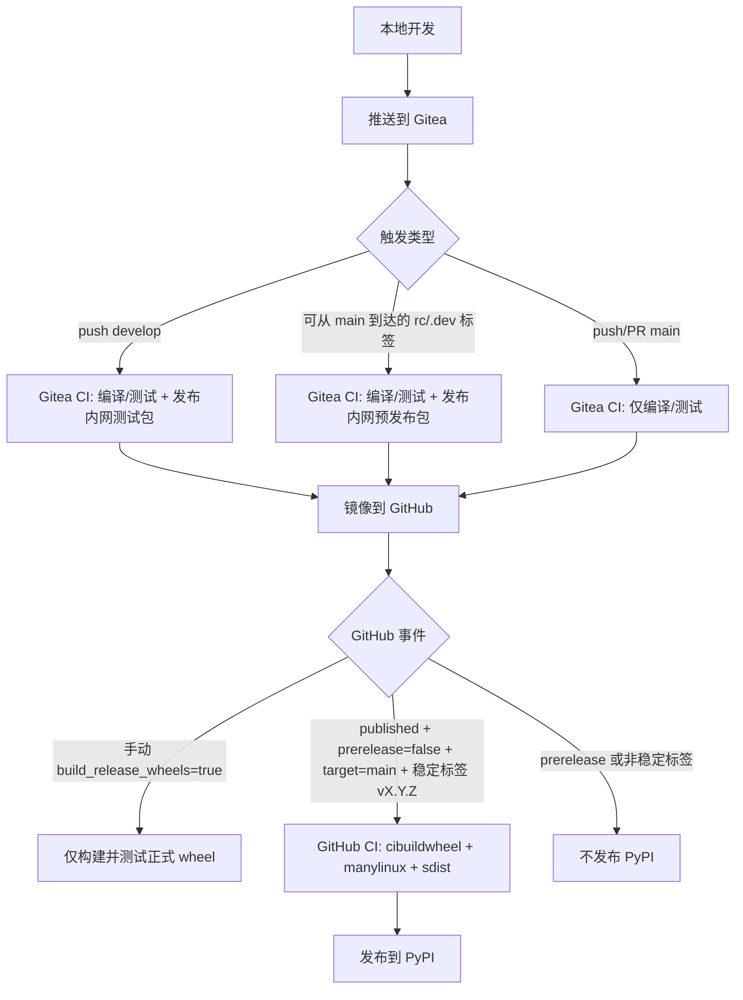

# 开发与发布指南

[English](DEVELOPMENT_RELEASE_GUIDE.md) | [中文](DEVELOPMENT_RELEASE_GUIDE.zh-CN.md)

本项目采用三通道发布模型：

1. `develop` 分支提交，自动发布内网测试包（Gitea）。
2. `main` 分支上的预发布标签（`rc` / `.dev`），发布内网预发布包（Gitea）。
3. 基于 `main` 稳定标签创建 GitHub 正式 Release，发布 PyPI 正式包。

## 发布流程图



## CI 职责

### Gitea 工作流

文件： [`.gitea/workflows/ci.yaml`](../../.gitea/workflows/ci.yaml)

- Linux 矩阵编译/测试，覆盖 Python `3.8` 到 `3.14`。
- 依赖源使用内网镜像：
  [`https://mirrors.zju.edu.cn/pypi/web/simple`](https://mirrors.zju.edu.cn/pypi/web/simple)。
- 内网 wheel 发布使用细粒度 `cibuildwheel` job，方便 Gitea 把 wheel 构建分发到多个 runner：
  - Linux x86_64 wheel 运行在 `ubuntu-latest` runner。
  - Linux aarch64 wheel 运行在原生 `ubuntu-24.04-arm64` runner。
  - `cp38`-`cp312` 使用 `manylinux2014` / glibc `>=2.17`。
  - `cp313`-`cp314` 使用 `manylinux_2_28`。
  - macOS arm64 wheel 按 CPython ABI 拆分，并运行在 `macos-arm64` runner。
- macOS arm64 runner 需要预装目标版本的 Python.org 官方 Python；`cibuildwheel`
  不会使用 `brew` 或 `uv` 安装的 Python 来构建 macOS wheel。
- 仓库发布基地址来自仓库变量 `SERVER_URL`。
- 满足以下任一条件时发布内网仓：
  - `push` 到 `develop`（测试包通道）；
  - `v*` 标签包含 `rc` 或 `.dev`，且校验为可从 `main` 到达（预发布通道）。

### GitHub 工作流

文件： [`.github/workflows/ci.yaml`](../../.github/workflows/ci.yaml)

- `build-and-test` 提供跨平台（Linux/macOS/Windows）验证，覆盖 `3.8` 到 `3.14`。
- GitHub 托管测试 job 使用 `setup-python` 的工具缓存和 `setup-uv` 的依赖缓存，
  并按操作系统与 Python 版本隔离。
- lint 通过 `uvx` 运行固定版本 Ruff，不安装 MolGR 的 RDKit/Open Babel 运行时依赖；
  测试 job 直接从 `pyproject.toml` 安装运行时依赖，不通过记录了本地镜像的 `uv.lock` 解析。
- Benchmark 依赖位于 [`benchmarks/pyproject.toml`](../../benchmarks/pyproject.toml)，故意不纳入根项目包元数据和正式发布依赖解析。
- 正式发布 wheel 使用 `cibuildwheel`，按平台分组构建：
  - Linux `cp38`-`cp312`：`manylinux2014` / glibc `>=2.17`，覆盖 `x86_64` 和 `aarch64`。
  - Linux `cp313`-`cp314`：`manylinux_2_28` / glibc `>=2.28`，覆盖 `x86_64` 和 `aarch64`。
  - Windows：AMD64；使用 `delvewheel` 修复原生依赖，但由已声明的 Open Babel
    依赖包提供 `openbabel-3.dll`。CPython 3.8 使用 `delvewheel 1.10.0`，更高版本
    Python 使用 `delvewheel 1.13.0`，因为 `delvewheel 1.11+` 要求 Python 3.9 或更高版本。
    CMake 链接两个依赖包系列都提供的 `openbabel/bin/openbabel-3.lib` 导入库。
  - macOS：`macos-15-intel` 原生 `x86_64`，`macos-latest` 显式指定 `arm64`；两者保留 `MACOSX_DEPLOYMENT_TARGET=14.0`。
- 运行时依赖中保持 `rdkit>=2023.9.6` 不锁死版本，让新系统可安装更新的 RDKit wheel，低 glibc 系统则由 pip 选择当前 Python/平台上最新的兼容 RDKit wheel。根目录 [`uv.lock`](../../uv.lock) 只是本地开发解析，可能在部分 Python 分支选择旧版 RDKit；它不是发布 wheel 的版本上限。
- 自动 Release 发布仅在以下条件全部满足时发布 PyPI：
  - `release.published`
  - `prerelease == false`
  - `target_commitish == main`
  - 标签以 `v` 开头
  - 标签不包含 `rc` / `.dev`
- 使用 `workflow_dispatch` 手动运行并设置 `build_release_wheels=true` 时，会构建并测试
  完整的正式 wheel 矩阵，并上传 workflow artifact 供检查，但不会发布到 PyPI，
  也不会向 GitHub Release 附加文件。

## 标签同步策略

镜像方向由 Gitea 项目设置管理。

## 必要变量与 Runner 配置

- 仓库变量：`SERVER_URL`
  - 示例：[`https://gitea.example.com:13000`](https://gitea.example.com:13000)
  - 用于拼接内网包仓发布/检查 URL。
- 包安装步骤会在运行 `pip` 或 `uv` 前显式清空代理变量。
- workflow 中没有硬编码代理兜底值；如果下载 action 本身需要代理，需要配置在
  runner/服务进程环境中，因为 action 下载发生在 job step 执行前。
- 仓库密钥：
  - `OWNER`
  - `PASSWORD`
Runner/action 解析配置：

- 当前 Gitea 工作流使用配置好的内网 action URL 上的 `checkout@v6`。
- 需在 Gitea 服务端配置 action 来源，例如 `DEFAULT_ACTIONS_URL=self` + 镜像 actions，
  或 `github` + 可出网。
- workflow 步骤不会为包安装配置代理。

若为单向镜像 `Gitea -> GitHub`：

- 本地/Gitea 创建的标签会同步到 GitHub；
- 仅在 GitHub 创建的标签不会自动回流到 Gitea。

推荐操作：

1. 先在本地/Gitea 创建标签。
2. 等待镜像同步到 GitHub。
3. 基于同步后的稳定标签创建 GitHub Release。

## 推荐操作流程

1. 在功能分支开发。
2. 合并到 `develop` 触发内网测试包持续发布。
3. 验证通过后合并到 `main`。
4. 需要内网预发布验证时，在 `main` 打 `vX.Y.ZrcN` 或 `vX.Y.Z.devN` 标签。
5. 首次公开发布前，可在 GitHub Actions 手动运行工作流，设置
   `build_release_wheels=true` 并检查全部 wheel artifact。
6. 正式发布时，在 `main` 打稳定标签 `vX.Y.Z` 并创建非 prerelease 的 GitHub Release。
7. 发布完成后检查 PyPI 与 GitHub Release 产物。

## 约束与守则

- `main` 的普通提交不能直接发布内网测试包。
- `develop` 是持续内网测试包通道。
- `main` 的 `rc` / `.dev` 标签是内网预发布通道。
- 稳定标签 `vX.Y.Z` 仅用于正式发布。


### 恢复中断的正式发布

修复 `main` 上的 CI 后，在 `main` 手动运行工作流并设置 `release_tag=v0.1.10`，
可明确启用该已有版本的重新构建和发布。工作流验证标签属于 `main` 历史，
且对应已发布、非预发布、目标为 `main` 的 GitHub Release，再将所有构建、测试和
部署固定到标签提交；不移动已发布标签。留空 `release_tag` 时，
`build_release_wheels=true` 仍只构建而不发布。

```sh
gh workflow run ci.yaml --ref main -f release_tag=v0.1.10
```
